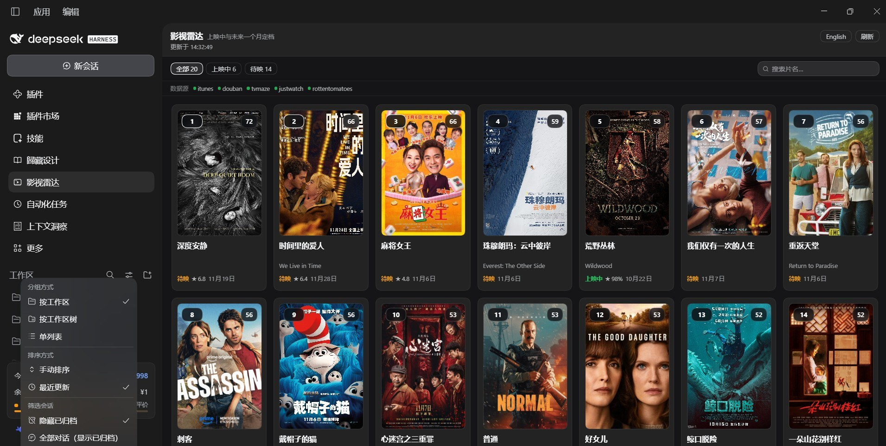

# dsh-movie · 影视雷达

A left-sidebar **screen radar** for [DeepSeek Harness](https://github.com/deepseek-ai): one ranked board of
the movies and series that are **in cinemas right now** or **open within the next month** across China, the
US, Europe, Japan and Korea — with real posters, five-sentence synopses, popular short comments, a title
search that merges three sources, and a live Chinese/English switch that translates everything.

[](https://www.npmjs.com/package/@hl3207/dsh-movie)
[](LICENSE)
[](package.json)
[](package.json)

[中文说明](README.zh.md)



*A real board, not a mock: poster grid with rank and score, 「全部 · 上映中 · 待映」 filters, the source-health
strip, and the title search at the right of the filter row.
[Settings page](https://raw.githubusercontent.com/hl3207/dsh-movie/main/docs/shots/settings.jpg).*

## Install

```sh
dsh plugin add @hl3207/dsh-movie
```
Or
```
**"Plugins" - "Add plugin" - Select "Registry Official npm registry" - Search and Install "@hl3207/dsh-movie"** in DeepSeek Harness. 
```

Then restart DeepSeek Harness. A film-strip entry appears in the left sidebar; click it and the board opens
in the main column. The first build takes 15–25 seconds (it queries six public sources and translates the
text); after that the board is cached for an hour and refreshes on demand.

You can also install it from the plugin market: **Plugins → Discover → search “影视雷达” or “dsh-movie”**.

Requirements: DeepSeek Harness `>=0.2.1-0 <0.3.0-0 || >=0.2.2-0 <0.3.0-0`, Node `^22.19.0 || >=24.0.0`. Desktop app and Web GUI
both work — nothing is Electron-specific, no port is hard-coded.

## What you get

| | |
| --- | --- |
| **Ranked board** | A composite of buzz, Rotten Tomatoes, Douban and audience anticipation, with diversity caps so one region or one media type cannot take over the list |
| **Posters, not placeholders** | The board is a poster grid (2:3 cards with rank and score overlaid). Click a card for the full record: large poster, whole synopsis, every comment. Posters are fetched by the Host and served from the plugin's own origin, so a source CDN's hotlink rules cannot blank them; a title with no reachable poster gets a designed plate that still reads as a card |
| **Title search** | The field at the right of 「全部 · 上映中 · 待映」 narrows the board as you type, then queries Douban, TVMaze and the iTunes storefront at once and merges their records for the same title into one row |
| **Five-sentence synopsis** | The real one from Douban / TVMaze / iTunes when it can be fetched, otherwise a description generated from the title's own metadata |
| **Ratings and comments** | Douban score, Tomatometer, IMDb, buzz and anticipation chips, plus up to three popular short comments |
| **Bilingual titles** | The title in your panel language leads, the original-language title follows as secondary text |
| **One switch, two languages** | Every synopsis and comment is translated into the language you picked, so the board never shows a Chinese comment inside an English panel |

## Sources

Every source is keyless — no API key, no account, nothing to configure.

| Source | Provides | Notes |
| --- | --- | --- |
| Douban (`m.douban.com`) | Chinese title, synopsis, genres, score, popular short comments, release date | Primary source for the China slate, and for the search |
| JustWatch | Poster, availability window, Tomatometer, IMDb score, buzz | Primary source for the US / Europe / Japan / Korea slate; its image CDN is unreachable on some networks, in which case the poster search below takes over |
| Douban `subject_suggest` | Poster search by title | Used when a source cover is dead: the title's own Douban poster is fetched and proxied |
| iTunes charts | Chart position (buzz), pre-orders, English `longDescription` | Storefronts per region; also the search's release dates and artwork |
| TVMaze | Series air dates, English summary, rating | Series only; also the search's series data |
| Rotten Tomatoes | Tomatometer via scrape | Best-effort; degrades to JustWatch's score when blocked |

Providers are independent: one unreachable source degrades the board and is reported in the panel's
source-health strip instead of failing the request.

## Search

Search runs on two levels, and it is the part people use most:

1. **Local, instantly** — typing the first character filters the current board by title, original title,
   media type and genre. The 「全部 · 上映中 · 待映」 filters keep working alongside it.
2. **On the web, after a 0.3 s pause** — the plugin asks Douban, TVMaze and iTunes in parallel and merges
   their answers: one record per title, Douban supplying the Chinese name / synopsis / genres / score,
   TVMaze the series data, iTunes the release date and artwork. Results are cached for ten minutes.

Matches that already sit on the board are grouped under 「榜单内」 (click through to the detail view); the
rest appear under 「全网搜索」 with poster, bilingual title, year · type · genres, Douban score, a three-line
synopsis, the sources that answered, and a link to the subject page.

Douban answers a burst of traffic with an empty body rather than an error, so the search retries that one
source with backoff (0.45 s / 1.3 s / 2.6 s) before giving up. If it still fails you get the English-only
results instead of an error.

## Translation

The anonymous HTTP translators (`translate.googleapis.com`, Bing) are not reachable from every network, so
the board goes through the Host `translator` service instead, which owns the keyless Bing/Google routes
together with their cancellation rules. One string per request, three in flight, a single probe before
committing so a blocked route costs one timeout instead of one per string, and a fixed time budget so a
slow route can never hold the board open. Every result is cached per language; a string that cannot be
translated keeps its source text and is counted in the panel's notice rather than failing the request.

When no keyless route is reachable at all, the plugin falls back to the session's own model route, asking
for one numbered line per input line and parsing it back.

Titles are treated as names: a translated title becomes the primary title only when it still reads like a
title, otherwise the source title stays primary and the translation is dropped rather than shown.

Set `translate: false` to keep everything in its source language, or pin a route with `translateProvider`.

## Configuration

Every key has a plugin-side default; the bundle seeds them so the row is self-documenting in the Plugins
settings page. Overriding the row replaces the whole `config` value (no deep merge) — restate every key you
want to keep.

```yaml
- id: dsh-movie
  config:
    regions: [china, us, europe, japan, korea]   # friendly names or ISO codes
    lookbackDays: 21        # how far back "in cinemas" still counts
    upcomingDays: 31        # the forward window
    limit: 20               # titles on the board
    language: auto          # auto | zh | en
    translate: true
    translateProvider: auto # auto tries bing, then google
    translateModel: ''      # only used by the model fallback route
    includeSeries: true
    doubanEnabled: true
    doubanEnrichLimit: 10   # how many rows get a synopsis/comments fetched
    commentLimit: 3         # popular comments per title (0-6)
    weights:
      heat: 0.28
      rt: 0.22
      douban: 0.28
      anticipation: 0.22
    cacheTtlMinutes: 60
```

## Tools and routes

The plugin gives the agent one tool and serves the panel from five routes, all relative to the page origin:

- Tool `movie_board` — `action: refresh | read | clear`, optional `locale` and `limit`.
- `GET  /dsh-movie/api/board?locale=zh|en` — the current board, built on first use.
- `POST /dsh-movie/api/refresh?locale=zh|en` — force a rebuild.
- `GET  /dsh-movie/api/search?q=<title>&locale=zh|en` — the merged title search.
- `GET  /dsh-movie/api/cover?u=<encoded url>` — the poster proxy: fetches the image with the `Referer` its
  CDN requires, caches it, and serves it same-origin. Only allowlisted hosts are fetched (`doubanio.com`,
  `douban.com`, `justwatch.com`, `tvmaze.com`, `mzstatic.com`, `wikimedia.org`, `wikipedia.org`).
- `GET  /dsh-movie/api/health` — build time, pick count and configured regions.
- `GET  /dsh-movie/api/wiring` — how this bundle appears in the browser boot graph. The sidebar icon comes
  from the Client half, which only loads with the page, so this is the fastest way to tell "not wired" from
  "not refreshed".

## Privacy

- No account, no API key, no telemetry, no analytics.
- What leaves the machine: the titles being looked up (public sources), the text that needs translating
  (through the Host translator service, i.e. the same routes the rest of the harness uses), and image
  requests for posters (through the plugin's own proxy).
- Nothing is written outside the profile's `node_modules` and the plugin's in-memory cache.

## Desktop and Web

The Host half serves the panel over plain relative HTTP routes on whatever origin the page was loaded from,
and the Client half registers through the shared slot system, so the same package works in the DeepSeek
Harness desktop app and in the browser build of the Web GUI. No Electron-only API, no fixed port, no
hard-coded `localhost`.

## Troubleshooting

| Symptom | Fix |
| --- | --- |
| No sidebar entry after installing | Reload the page: the Client half (and therefore the icon) only loads with the page |
| Board says the providers could not fill it | Hit 「刷新」 once; the sources are rate-limited, not down |
| Some posters are missing | A CDN was unreachable for that title. It retries on the next refresh; the designed plate is intentional |
| Search finds nothing for a Chinese title | Douban throttles during a board build. Wait a few seconds and search again |
| `ERR_PNPM_EPERM` while installing | A running process holds a package directory. Quit the app, then install |

## Contributing

Issues and pull requests are welcome. See
[CONTRIBUTING.md](https://github.com/hl3207/dsh-movie/blob/main/CONTRIBUTING.md) for the two commands that
check the release, and [DEVELOPING.md](https://github.com/hl3207/dsh-movie/blob/main/DEVELOPING.md) for
running it from a local checkout.

## License

Apache-2.0 — see [LICENSE](LICENSE). Copyright 2026 hl3207.

This plugin is not affiliated with Douban, JustWatch, TVMaze, Apple or Rotten Tomatoes: titles, posters,
synopses and ratings belong to their owners and are shown here for discovery purposes. The package ships
no data — the board is built at runtime from those public sources.
