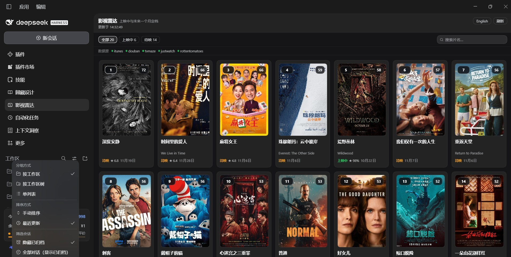

# 影视雷达 · dsh-movie

给 [DeepSeek Harness](https://github.com/deepseek-ai) 用的**左侧边栏影视雷达**：把正在上映、以及未来一个月内定档的电影和剧集（中国 / 美国 / 欧洲 / 日本 / 韩国）汇成一张榜单，带真实海报、五句以内剧情简介、热门短评，还有一个把豆瓣 / TVMaze / iTunes 三路结果合并起来的片名搜索，中英文一键切换、简介和评论自动跟着翻译。

[](https://www.npmjs.com/package/@hl3207/dsh-movie)
[](LICENSE)
[](package.json)
[](package.json)

[English](README.md)



*真实面板，不是效果图：海报网格叠着排名和评分，「全部 · 上映中 · 待映」筛选、数据源健康条，以及筛选栏右侧的片名搜索。
[插件设置页](https://raw.githubusercontent.com/hl3207/dsh-movie/main/docs/shots/settings.jpg)。*

## 安装

```sh
dsh plugin add @hl3207/dsh-movie
```

装完重启 DeepSeek Harness，左侧边栏会出现一个胶片图标，点开即可在中间栏看到榜单。首次构建要 15–25 秒（它要去六个公开数据源取数并翻译文本），之后榜单缓存一小时，也可以随时手动刷新。

也可以从插件市场装：**Plugins → Discover → 搜「影视雷达」或「dsh-movie」**。

环境要求：DeepSeek Harness `>=0.2.1-0 <0.3.0-0 || >=0.2.2-0 <0.3.0-0`、Node `^22.19.0 || >=24.0.0`。桌面版和网页版都能用——不依赖任何 Electron 专有接口，不写死端口。

## 你会看到什么

| | |
| --- | --- |
| **排行榜** | 热度、烂番茄、豆瓣、观众期待度加权，并带多样性上限，不让某个地区或某类作品霸榜 |
| **真海报，不是占位图** | 榜单本身就是海报网格（2:3 卡片，角上叠排名和评分）；点开是完整档案：大图、完整简介、全部短评。海报由 Host 取回后从插件自己的源下发，图站的热链规则拦不住；确实找不到海报的作品会画一张设计过的占位卡，而不是留一个破图标 |
| **片名搜索** | 在「全部 · 上映中 · 待映」右侧的搜索框里输入即筛榜单；停顿 0.3 秒后插件并行问豆瓣、TVMaze、iTunes，把同一部作品的记录合并成一条 |
| **五句以内简介** | 能取到就用豆瓣 / TVMaze / iTunes 的原始简介；取不到就用作品自己的元数据生成一段，而不是留空 |
| **评分与短评** | 豆瓣分、烂番茄、IMDb、热度、期待度指标，外加最多三条热门短评 |
| **双标题** | 当前语言的主标题在前，原文名作为副标题跟在后面 |
| **一个开关两种语言** | 简介和评论都会翻成你选的语言，英文面板里不会混进中文短评 |

## 数据源

所有数据源都免密钥——不需要 API Key，不需要账号，不用配置。

| 来源 | 提供 | 说明 |
| --- | --- | --- |
| 豆瓣（`m.douban.com`） | 中文片名、简介、题材、评分、热门短评、上映日期 | 中国档期的主力来源，搜索也用它 |
| JustWatch | 海报、可看窗口、烂番茄分、IMDb 分、热度 | 美 / 欧 / 日 / 韩档期的主力来源；它的图床在部分网络不可达，此时由下面的海报搜索兜底 |
| 豆瓣 `subject_suggest` | 按片名搜海报 | 源海报失效时，用作品自己的豆瓣海报补位并同源下发 |
| iTunes 榜单 | 榜单排名（热度）、预售、英文 `longDescription` | 按地区分店；也是搜索的上映日期与剧照来源 |
| TVMaze | 剧集播出时间、英文简介、评分 | 仅剧集；也是搜索的剧集数据来源 |
| 烂番茄 | 抓取的烂番茄分 | 尽力而为；被拦时退回 JustWatch 的分数 |

各数据源彼此独立：某个源不可达只会让榜单降级（面板上的数据源健康条会标出来），不会让整次请求失败。

## 搜索

搜索分两层，也是平时用得最多的一块：

1. **本地，即时**——输入第一个字就开始按片名、原名、影剧类型、题材筛当前榜单，「全部 · 上映中 · 待映」照常叠加生效。
2. **联网，停顿 0.3 秒后**——插件并行问豆瓣、TVMaze、iTunes，一个作品只出一条记录：豆瓣补中文名 / 简介 / 题材 / 评分，TVMaze 补剧集数据，iTunes 补上映日期和剧照。结果缓存 10 分钟。

榜单里已有的命中归到「榜单内」（点一下就是详情页），其余放在「全网搜索」：海报、中英文名、年份 · 类型 · 题材、豆瓣分、三行简介、命中的数据源，以及「打开详情页」链接。

豆瓣在流量突增时会返回空响应而不是报错，所以搜索会对这一路做退避重试（0.45 s / 1.3 s / 2.6 s）；仍失败就只给英文结果，而不是直接报错。

## 翻译

匿名 HTTP 翻译接口（`translate.googleapis.com`、Bing）并非在每个网络都可达，所以榜单走 Host 的 `translator` 服务——它统一持有免密钥的 Bing / Google 通道以及取消规则。一次一条文本、三路并发、先探一次再批量提交（一条被墙的通道只花一次超时，而不是每条文本各花一次），并设了总时间预算，慢通道拖不住整个榜单。每个结果按语言缓存；翻译不出来的那条保留原文并在面板上计数，而不是让整次请求失败。

完全找不到免密钥通道时，会退回当前会话自己的模型通道，按「一行一条」的格式请求并逐行解析。

标题按名字处理：只有译文仍像一个标题时才让它当主标题，否则保留原文标题、丢掉译文，而不是把一句解释当片名显示。

设置 `translate: false` 可全部保留原文，或用 `translateProvider` 指定通道。

## 配置

每个键在插件里都有默认值，bundle 里写出来是为了让这一行在「插件设置」里自解释。覆盖这一行会整体替换 `config`（不做深合并），要保留的键请一并写全。

```yaml
- id: dsh-movie
  config:
    regions: [china, us, europe, japan, korea]   # 友好名或 ISO 代码
    lookbackDays: 21        # 「正在上映」回看多少天
    upcomingDays: 31        # 向前看多少天
    limit: 20               # 榜单条数
    language: auto          # auto | zh | en
    translate: true
    translateProvider: auto # auto 先试 bing 再试 google
    translateModel: ''      # 仅模型兜底通道使用
    includeSeries: true
    doubanEnabled: true
    doubanEnrichLimit: 10   # 多少条去取简介和短评
    commentLimit: 3         # 每条几则短评（0-6）
    weights:
      heat: 0.28
      rt: 0.22
      douban: 0.28
      anticipation: 0.22
    cacheTtlMinutes: 60
```

## 工具与路由

插件给 agent 一个工具，并从页面同源提供五组路由：

- 工具 `movie_board` —— `action: refresh | read | clear`，可选 `locale`、`limit`。
- `GET  /dsh-movie/api/board?locale=zh|en` —— 读当前榜单，空榜会自建。
- `POST /dsh-movie/api/refresh?locale=zh|en` —— 强制重建。
- `GET  /dsh-movie/api/search?q=<片名>&locale=zh|en` —— 合并后的片名搜索。
- `GET  /dsh-movie/api/cover?u=<编码后的地址>` —— 海报代理：按图站要求的 `Referer` 取图、缓存、同源下发。只抓白名单域名（`doubanio.com`、`douban.com`、`justwatch.com`、`tvmaze.com`、`mzstatic.com`、`wikimedia.org`、`wikipedia.org`）。
- `GET  /dsh-movie/api/health` —— 构建时间、条数与生效区域。
- `GET  /dsh-movie/api/wiring` —— 这个 bundle 在浏览器启动图里的样子。侧栏图标来自只在页面加载时才跑起来的 Client 半边，所以「没接上」和「没刷新」用它能一眼分清。

## 隐私

- 不需要账号、不需要 API Key，没有遥测、没有统计。
- 离开本机的只有：要查的片名（发给公开数据源）、需要翻译的文本（走 Host 的翻译服务，也就是 harness 其他地方在用的同一批通道）、以及取海报时的图片请求（经插件自己的代理）。
- 除 profile 的 `node_modules` 和插件内存缓存之外，不写任何文件。

## 桌面版与网页版

Host 半边用相对路径在页面自己的源上提供面板数据，Client 半边通过共享 Slot 系统注册，所以同一个包在 DeepSeek Harness 桌面版和网页版里都能用：不依赖 Electron 专有 API、不写死端口、不写死 `localhost`。

## 常见问题

| 现象 | 处理 |
| --- | --- |
| 装完左侧没有图标 | 刷新页面：Client 半边（也就是图标）只在页面加载时才会起来 |
| 榜单提示数据源没填满 | 点一次「刷新」。通常是限流，不是服务挂了 |
| 部分海报缺失 | 那部作品的图床当时不可达，下次刷新会重试；设计好的占位卡是有意为之 |
| 中文片名搜不到 | 豆瓣在榜单构建后限流。等几秒再搜 |
| 安装时报 `ERR_PNPM_EPERM` | 有进程正占用相关包目录。退出应用后再装 |

## 参与

欢迎提 issue 和 PR。发布前的两条检查命令见
[CONTRIBUTING.md](https://github.com/hl3207/dsh-movie/blob/main/CONTRIBUTING.md)，从本地源码跑起来见
[DEVELOPING.md](https://github.com/hl3207/dsh-movie/blob/main/DEVELOPING.md)。

## 许可

Apache-2.0，见 [LICENSE](LICENSE)。Copyright 2026 hl3207。

本插件与豆瓣、JustWatch、TVMaze、Apple、烂番茄均无隶属关系：片名、海报、简介与评分的权利属于各自所有者，这里仅用于发现与浏览。包里不带任何数据——榜单是运行时从这些公开来源现取的。
